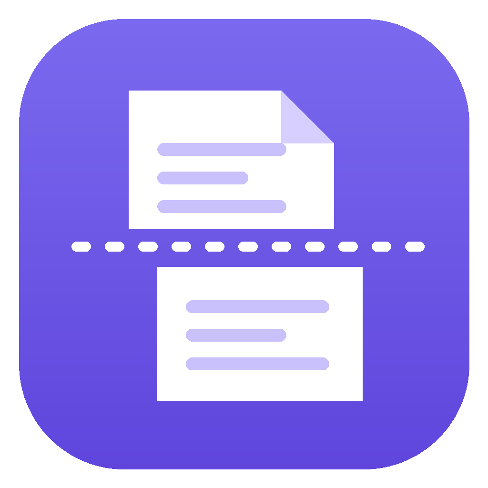

<p align="center">
  
</p>

<h1 align="center">PDF 분할기</h1>

<p align="center">너무 커서 안 올라가는 PDF를 원하는 페이지에서 깔끔하게 잘라 주는 Windows용 프로그램</p>

---

## 할 수 있는 것

| 방식 | 이렇게 넣으면 | 이렇게 나뉘어요 |
|---|---|---|
| **페이지 지정** | `100, 250` | 1–100 / 101–250 / 251–끝 |
| | `1-100, 300-400` | 적은 구간만 뽑기 |
| **쪽 수로** | 한 조각에 `50`쪽씩 | 1–50 / 51–100 / … |
| | 똑같이 `4`개로 | 쪽 수가 비슷한 4개 |
| **용량 기준** | 최대 `100` MB | 조각마다 100MB 이하가 되도록 자동으로 맞춤 |

- 페이지 미리보기를 넘겨 보다가 **✂ 이 쪽 뒤에서 자르기** 버튼으로 자르는 곳을 바로 추가할 수 있어요
- 나뉠 조각과 예상 용량을 목록으로 먼저 보여 주고, 다 만들면 실제 용량으로 바뀌어요
- PDF를 창에 끌어다 놓거나, 탐색기에서 **우클릭 → 보내기 → PDF 분할기**로 열 수 있어요
- 700MB가 넘는 큰 파일도 문제없어요 (qpdf 기반 `pikepdf` 엔진, 없으면 `pypdf`로 동작)
- 원본은 건드리지 않아요. 결과는 원본 옆 `파일이름_분할` 폴더에 `파일이름_01_p1-100.pdf` 식으로 저장돼요

## 설치

1. 오른쪽 **Code → Download ZIP** 으로 받아서 압축을 풀어요
2. `1_install.bat` 를 더블클릭해요 (파이썬이 없으면 자동으로 설치해요)
3. 바탕화면의 **PDF 분할기** 를 켜요 (또는 `2_run.bat`)

> 파이썬을 새로 설치했다면 안내대로 `1_install.bat` 를 한 번 더 실행해 주세요.

## 쓰는 법

1. PDF를 창에 끌어다 놓거나 **파일 고르기**
2. 나누는 방식을 고르고 숫자 입력
3. **분할 시작 ▶** → 끝나면 **폴더 열기**

## 파일 구성

```
app.py          창(GUI)
splitter.py     분할 엔진
1_install.bat   설치 (패키지 + 바로가기)
2_run.bat       실행
icon.ico        아이콘
```

## 지우기

압축을 푼 폴더, 바탕화면 바로가기, `shell:sendto` 폴더의 `PDF 분할기` 바로가기를 지우면 끝이에요.

## 라이선스

MIT
